# AiSOC architecture and data flow

This diagram describes the checked-in Docker Compose deployment and the
code-backed event path. Compose host ports below use the default loopback
binding (`127.0.0.1`); optional profiles are called out separately. The
`Security-Log-Generator` adapter is an example companion repository, not an
AiSOC Compose service.

## Architecture diagram

```mermaid
flowchart TD
  subgraph zone_sources["1. Log sources and ingestion"]
    ext_logs["External SIEM, EDR, cloud and application telemetry"]:::source
    cisa["CISA KEV public feed"]:::source
    mitre["MITRE ATT&CK Enterprise STIX corpus<br/>local bundle or CDN fallback"]:::intel
    connectors["Connectors scheduler<br/>host :8088 -> container :8003"]:::ingest
    adapter["Security-Log-Generator<br/>log_adapter.py (optional companion)"]:::source
    ingest["Go ingest HTTP API<br/>host :8081 -> container :8080<br/>POST /v1/ingest and /v1/ingest/batch"]:::ingest
    normalize["Normalizer<br/>connector profile -> OCSF 1.1.0<br/>activity and entity projections"]:::ingest
  end

  subgraph zone_core["2. Core processing and application"]
    fusion["Fusion and detection<br/>host :8003 -> container :8003<br/>rules, correlate, promote"]:::core
    api["AiSOC REST API<br/>host :8000 -> container :8000"]:::core
    threatintel["Threat intelligence service<br/>host :8005 -> container :8005"]:::intel
    agents["Agent decision pipeline<br/>host :8001 -> container :8084<br/>consume fused alerts; triage"]:::core
    actions["Governed actions service<br/>host :8002 -> container :8085"]:::core
    realtime["Realtime gateway<br/>host :8086 -> container :4000"]:::core
    enrichment["Enrichment service<br/>full profile only"]:::optional
    ueba["UEBA consumer<br/>full profile only"]:::optional
  end

  subgraph zone_ai["3. AI model routing"]
    gateway["LiteLLM router<br/>host :4000 -> container :4000<br/>OpenAI-compatible /v1 task aliases"]:::ai
    ollama["Ollama local inference<br/>host :11434 -> container :11434<br/>default: llama3.2:3b-instruct-q4_K_M"]:::ai
    hosted["Optional hosted model provider<br/>configured by environment"]:::optional
    fallback["Deterministic triage fallback<br/>inside agents service"]:::ai
  end

  subgraph zone_data["4. Data and persistence"]
    postgres["PostgreSQL<br/>host :5432 -> container :5432<br/>operational records, alerts, audit"]:::store
    redis["Redis<br/>host :6379 -> container :6379<br/>cache and runtime state"]:::store
    kafka["Kafka broker<br/>host :9092; internal :29092<br/>raw_events, alerts.fused and other topics"]:::store
    zookeeper["ZooKeeper<br/>internal :2181; no host publish"]:::optional
    qdrant["Qdrant vector store<br/>host :6333 -> container :6333<br/>threat intel, ATT&CK and semantic memory"]:::store
    clickhouse["ClickHouse event lake<br/>full profile only<br/>host :8123 HTTP, :9000 native"]:::optional
    opensearch["OpenSearch IOC full-text search<br/>full profile only<br/>host :9200"]:::optional
    neo4j["Neo4j entity graph<br/>full profile only<br/>host :7474 HTTP, :7687 Bolt"]:::optional
  end

  subgraph zone_ui["5. Presentation and user interface"]
    analyst["Security analyst"]:::source
    web["Web console<br/>host :3000 -> container :3000<br/>same-origin API, agent and realtime proxies"]:::ui
  end

  ext_logs -->|poll vendor APIs| connectors
  connectors -->|HTTP POST /v1/ingest/batch| ingest
  adapter -->|HTTP POST /v1/ingest/batch| ingest
  ingest -->|normalize request payload| normalize
  mitre -->|STIX technique metadata| normalize
  normalize -->|Kafka publish: aisoc.raw_events| kafka
  kafka -->|consume: aisoc.raw_events| fusion
  fusion -->|publish: aisoc.alerts.fused| kafka
  fusion -->|SQL: persist promoted alerts| postgres
  kafka -->|consume: aisoc.alerts.fused| agents

  cisa -->|scheduled HTTPS feed fetch| threatintel
  threatintel -->|HTTP: IOC and actor vectors| qdrant
  threatintel -.->|optional full-text index| opensearch
  api -->|HTTP REST: threat-intel proxy| threatintel

  ingest -->|SQL: ingest credentials and inbox| postgres
  ingest -->|Redis cache| redis
  fusion -->|SQL: alert and fusion records| postgres
  fusion -->|Redis cache| redis
  agents -->|SQL: investigation ledger| postgres
  agents -->|Redis cache| redis
  agents -->|optional ATT&CK RAG| qdrant
  api -->|SQL: application data| postgres
  api -->|Redis cache| redis
  api -->|HTTP REST: semantic memory| qdrant

  agents -->|OpenAI-compatible REST: task alias| gateway
  gateway -->|Ollama API: configured model| ollama
  gateway -.->|if configured instead of local| hosted
  agents -->|no key, circuit open or model failure| fallback
  fallback -->|deterministic verdict| agents
  mitre -->|ATT&CK corpus load| agents

  fusion -.->|HTTP enrichment; full profile| enrichment
  kafka -.->|UEBA stream; full profile| ueba
  fusion -.->|event archive; full profile| clickhouse
  api -.->|lake queries; full profile| clickhouse
  api -.->|entity graph access; full profile| neo4j
  agents -.->|entity context; full profile| neo4j
  zookeeper -->|broker coordination| kafka

  analyst -->|browser HTTPS/HTTP| web
  web -->|same-origin REST proxy| api
  web -->|agent routes proxy| agents
  api -->|internal HTTP| actions
  api -->|internal HTTP and realtime tickets| realtime
  web -->|WebSocket proxy| realtime

  classDef source fill:#f1f5f9,stroke:#475569,color:#0f172a;
  classDef ingest fill:#dbeafe,stroke:#2563eb,color:#172554;
  classDef core fill:#e0e7ff,stroke:#4f46e5,color:#1e1b4b;
  classDef intel fill:#fef3c7,stroke:#d97706,color:#451a03;
  classDef ai fill:#ede9fe,stroke:#7c3aed,color:#2e1065;
  classDef store fill:#dcfce7,stroke:#16a34a,color:#052e16;
  classDef ui fill:#ffedd5,stroke:#ea580c,color:#431407;
  classDef optional fill:#f8fafc,stroke:#64748b,stroke-dasharray:4 3,color:#334155;
```

## End-to-end event path

1. **Sources and connectors.** External telemetry is polled by the connectors
   service, which submits batches to the Go ingest API. A push integration can
   post directly to the same API. For example, the adjacent
   `Security-Log-Generator/log_adapter.py` submits synthetic records to
   `POST /v1/ingest/batch`; that adapter is not part of this repository's
   Compose stack.
2. **Authentication and normalization.** Ingest validates the credential and
   tenant scope, converts each payload through the connector normalizer into
   an OCSF-shaped event, and publishes accepted events to Kafka topic
   `aisoc.raw_events`. Ingest also loads MITRE ATT&CK technique metadata from
   its local STIX bundle, falling back to the MITRE CTI CDN if necessary.
3. **Detection and promotion.** Fusion consumes `aisoc.raw_events` (and raw
   alert inputs), archives events to ClickHouse when the full-profile lake is
   enabled, evaluates detections, and promotes eligible findings. It persists
   fused alert records in PostgreSQL and publishes them to
   `aisoc.alerts.fused`.
4. **Triage and AI routing.** The agents service consumes fused alerts and
   runs auto-triage. Its logical task aliases route through LiteLLM to the
   configured model. With the default Compose configuration, fast and deep
   aliases use Ollama's `llama3.2:3b-instruct-q4_K_M`. If no usable LLM is
   configured, the circuit is open, or a call fails, the agent pipeline can
   run deterministic triage instead. Auto-triage is read-only; response
   actions go through the governed actions service, not an automatic model
   dispatch.
5. **Threat intelligence and presentation.** The threat-intel scheduler fetches
   CISA KEV and stores indicator/actor vectors in Qdrant. The agents load the
   ATT&CK corpus; ATT&CK embeddings are written to Qdrant when the configured
   embedding credentials are available. The Web console reaches the API,
   agent routes, and realtime service through its same-origin proxies.

## Service, profile, port, and network inventory

Published ports are written as `host:container`. Unless overridden, the host
side binds to `127.0.0.1`, not every network interface. Services communicate
over the Compose bridge network named `aisoc` using service DNS names. Kafka
uses `kafka:29092` between containers; host clients use the published
`127.0.0.1:9092` listener.

| Compose service | Profile | Published host ports | Purpose |
| --- | --- | --- | --- |
| `postgres` | default | `5432:5432` | Relational application and audit store |
| `redis` | default | `6379:6379` | Cache and runtime state |
| `zookeeper` | default | none (internal `2181`) | Kafka coordination |
| `kafka` | default | `9092:9092` (internal broker listener `29092`) | Event transport |
| `qdrant` | default | `6333:6333` | Vector store |
| `api` | default | `8000:8000` | REST backend |
| `ingest-worker` | default | `8081:8080`, `9090:9090` | Ingest HTTP API and metrics |
| `fusion` | default | `8003:8003` | Detection, correlation, alert promotion |
| `agents` | default | `8001:8084` | Agent APIs and fused-alert triage worker |
| `ollama` | default | `11434:11434` | Local inference |
| `ollama-pull` | default | none (one-shot) | Attempts to fetch the configured Ollama model |
| `litellm` | default | `4000:4000` | Model routing gateway |
| `actions` | default | `8002:8085` | Governed response-action API |
| `connectors` | default | `8088:8003` | Scheduled vendor connectors |
| `threatintel` | default | `8005:8005` | Threat-intelligence feed and API service |
| `realtime` | default | `8086:4000` | Realtime API/WebSocket service |
| `web` | default | `3000:3000` | Analyst console |
| `kafka-ui` | `full` | `8090:8080` | Kafka topic browser |
| `clickhouse` | `full` | `8123:8123`, `9000:9000` | Event lake |
| `opensearch` | `full` | `9200:9200` | Optional full-text IOC search |
| `neo4j` | `full` | `7474:7474`, `7687:7687` | Entity graph |
| `enrichment` | `full` | `8080:8082` | Fuse-time external enrichment |
| `ueba` | `full` | `8007:8004` | UEBA stream consumer |
| `osquery-tls` | `osquery` | `8091:9001` | Osquery TLS/enrollment service |
| `honeytokens` | `extras` | `8008:8005` | Honeytoken service |
| `purple-team` | `extras` | `8006:8006` | Purple-team service |
| `slack-bot` | `chatops` | `8009:8089` | Slack ChatOps adapter |
| `teams-bot` | `chatops` | `8010:8090` | Teams ChatOps adapter |
| `escalations` | `escalations` | none | Scheduled escalation worker |
| `mcp` | `mcp` | `8096:8096` | MCP server |
| `prometheus` | `monitoring` | `9091:9090` | Metrics collection |
| `alertmanager` | `monitoring` | `9094:9093` | Alert routing |
| `otel-collector` | `monitoring` | `4317:4317`, `4318:4318` | OTLP receiver |
| `tempo` | `monitoring` | `3200:3200` | Trace storage/query |
| `grafana` | `monitoring` | `3001:3000` | Observability dashboards |

Services marked `default` have no Compose `profiles` key and start with the
base stack. Other rows require the named profile. The `full` profile adds the
event lake, enrichment, UEBA, graph, full-text search, and Kafka UI. The
monitoring, ChatOps, extras, osquery, escalations, and MCP profiles are
separately opt-in.

## Persistence and AI details

- **PostgreSQL** stores application entities, promoted alerts, investigation
  records, and audit data. Runtime services use the `aisoc_app` role; the
  `aisoc` owner is reserved for migrations.
- **Kafka** is the event spine. The primary normalized-event topic is
  `aisoc.raw_events`; fusion publishes promoted alerts to
  `aisoc.alerts.fused`. The broker is exposed to the host on 9092, while
  Compose clients use 29092. ZooKeeper is internal-only.
- **Redis** is configured as a cache/runtime state store for the API, ingest,
  fusion, agents, and other services. It is not the event queue.
- **Qdrant** stores threat-intelligence IOC/actor vectors, optional
  ATT&CK-technique embeddings for agent RAG, and semantic-memory vectors used
  by the API. Threat-intelligence local embedding uses FastEmbed when enabled.
- **Full-profile stores** are optional: ClickHouse holds the event lake;
  OpenSearch adds full-text IOC search; Neo4j backs entity-graph queries.
- **LiteLLM** maps task aliases to model configuration in
  `infra/litellm/config.yaml`. Compose defaults the FAST and DEEP model
  variables to `ollama_chat/llama3.2:3b-instruct-q4_K_M` and the local model
  pull to `llama3.2:3b-instruct-q4_K_M`. GPU and host-LLM overlays contain
  different defaults; hosted providers can also be selected through
  environment configuration.
- **Model name correction:** `qwen2.5-coder:3b` is not configured in the
  checked-in default Compose or LiteLLM configuration. The default local model
  is the Llama 3.2 tag shown above.

## Source map

- Runtime services, profiles, port bindings, bridge network, and service
  environment: [`docker-compose.yml`](./docker-compose.yml) and
  [`.env.example`](./.env.example).
- Ingest routes and normalization: [`server.go`](./services/ingest/internal/server/server.go),
  [`handler.go`](./services/ingest/internal/handler/handler.go),
  [`normalizer.go`](./services/ingest/internal/normalizer/normalizer.go), and
  [`publisher.go`](./services/ingest/internal/publisher/publisher.go).
- Connector-to-ingest HTTP client:
  [`ingest_client.py`](./services/connectors/app/ingest_client.py).
- Fusion Kafka consumer and alert persistence:
  [`consumer.py`](./services/fusion/app/workers/consumer.py) and
  [`alert_sink.py`](./services/fusion/app/services/alert_sink.py).
- Agent fused-alert consumer and ATT&CK RAG:
  [`fused_alert_consumer.py`](./services/agents/app/workers/fused_alert_consumer.py),
  [`main.py`](./services/agents/app/main.py), and
  [`mitre_full.py`](./services/agents/app/tools/mitre_full.py).
- ATT&CK corpus loader:
  [`loader.go`](./services/ingest/internal/attck/loader.go).
- Threat-intel feed and vector storage:
  [`cisa_kev.py`](./services/threatintel/app/clients/cisa_kev.py),
  [`main.py`](./services/threatintel/app/main.py), and
  [`qdrant.py`](./services/threatintel/app/storage/qdrant.py).
- LiteLLM aliases:
  [`config.yaml`](./infra/litellm/config.yaml).
- API semantic memory:
  [`semantic_memory.py`](./services/api/app/services/semantic_memory.py).
